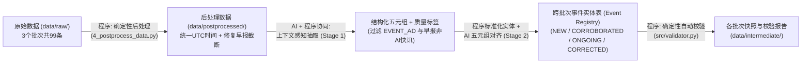

# Daily_AI_Insight_Engine（AI 舆情分析日报系统）

本项目是一个面向多源异构中英文科技资讯的 **跨批次增量事件抽取、实体对齐与舆情演进追踪系统**。系统支持从原始抓取数据出发，按时间批次（`BATCH-1: 2026-11-02` $\rightarrow$ `BATCH-2: 2026-11-03` $\rightarrow$ `BATCH-3: 2026-11-04`）顺序完成数据清洗、上下文感知五元组抽取、跨语种事件归并、数据口径冲突修正及程序化校验。

---

## 一、快速启动（一键运行全流程）

系统核心流水线全部基于 Python 3.10+ 标准库构建，无需安装复杂第三方依赖即可运行；同时内置 **API 实时调用 + SHA-256 本地确定性响应缓存（`data/cache/llm_cache.json`）** 双保险机制，无论是否配置外部 API Key 均可一键复现完整流程：

```bash
# 1. （可选）如需实时调用大模型 API，可复制 .env.example 为 .env 并填入密钥；
#    若不配置 .env，系统将自动命中 data/cache/llm_cache.json 完成确定性复现。
cp .env.example .env

# 2. 一键从原始数据开始按批次顺序跑完全流程（后处理清洗 -> 三批次抽取与事件表演进 -> 自动校验）
python run_pipeline.py
```

### 目录与核心交付物结构

```text
├── run_pipeline.py                  # 一键全流程主入口
├── .env.example                     # 环境变量配置模板（真实密钥已通过 .gitignore 隔离）
├── rules/                           # 【规则文件】
│   ├── event_taxonomy_and_merge_rules.json  # 6大事件分类、6类质量标签、实体别名表与归并规则配置
│   └── event_rules_spec.md                  # 事件分类体系与跨批次归并演进规则说明
├── data/
│   ├── raw/                         # 【原始数据】99 条中英文跨 3 日原始抓取数据（保持原样不修改）
│   ├── postprocessed/               # 【后处理数据】统一 UTC 时间戳并修复极客公园早报截断后的数据
│   ├── intermediate/                # 【中间产物】各批次结构化抽取结果、事件实体表快照与校验报告
│   │   ├── batch_1_2026-11-02_extractions.json & batch_1_2026-11-02_events.json
│   │   ├── batch_2_2026-11-03_extractions.json & batch_2_2026-11-03_events.json
│   │   ├── batch_3_2026-11-04_extractions.json & batch_3_2026-11-04_events.json
│   │   ├── entity_aliases_snapshot.json     # 跨批次动态扩充后的实体别名映射表
│   │   ├── merge_audit_log.json             # 跨条目/跨批次归并决策审计日志
│   │   └── validation_report.json / .md     # 自动化程序校验报告
│   └── cache/llm_cache.json         # 本地确定性 LLM 响应缓存
├── docs/                            # 【数据文档】
│   ├── data_collection_log.md       # 数据采集记录（信息源、筛选规则、正文扩充与丢弃案例）
│   └── data_issues.md               # 7 类真实数据质量问题清单与典型 Item 溯源
├── scripts/                         # 数据采集、筛选、正文扩充与确定性后处理脚本 (1~4_*.py)
└── src/                             # 核心流水线源码（LLM 客户端、上下文感知抽取与归并器、自动校验器）
```

---

## 二、数据源说明：选型、取舍与可靠度评估

详见 [`docs/data_collection_log.md`](file:///d:/Pcode/outside/data_vis/docs/data_collection_log.md)。系统共从 **12 个国内外信息源** 采集并筛选出连续 3 天（`2026-11-02` 至 `2026-11-04`）的 **99 条有效资讯（英文 63 条，中文 36 条）**，覆盖三大信息源类型：

| 类别 | 采纳信息源 | 选型原因与可靠度评估 | 放弃/未入选的候选源及原因 |
| :--- | :--- | :--- | :--- |
| **1. 中英文科技媒体** | **TechCrunch AI、The Verge AI、Ars Technica、MIT Tech Review、量子位、极客公园、Solidot、OSChina** | **覆盖广、时效快**：能第一时间捕捉产品发布、投融资与商业落地的跨语种报道。<br>**可靠度痛点**：国内部分媒体（如量子位）存在标题党夸大（`EXAGGERATED_TITLE`）与授权公关软文（`PR_PROMOTION`）；极客公园早报属于多事件大杂烩（`MULTI_TOPIC_DIGEST`），且含非 AI 硬件/车企快讯；TechCrunch 混有线下峰会售票广告（`EVENT_AD`）。 | **机器之心 / 36氪**：RSS 接口存在未转义字符导致 XML 解析错误或仅返回历史旧文。<br>**VentureBeat / 少数派**：抓取阶段触发 HTTP 429 限流或近 3 日无纯 AI 硬核报道。 |
| **2. 企业与学术官方渠道** | **OpenAI Blog、Google AI Blog、arXiv (`cs.AI`/`cs.LG`)** | **一手权威信源**：官方公告与学术预印本在技术参数、模型架构与合规声明上可靠度最高，可作为修正二手媒体夸大或数据偏差的基准锚点。 | **Anthropic / Meta 官方博客**：无标准公开全文 RSS，其核心动态通过一手招股书披露报道与社区信源覆盖。 |
| **3. 技术社区与开发者讨论** | **Hacker News**（通过 Algolia API 检索高赞帖并抓取前排高赞评论） | **高价值交叉验证与辟谣**：社区一线的工程师评论能有效指出官方财报/公关稿背后的统计口径猫腻（如指出 Anthropic 净亏损源于可转换票据公允价值变动、指出 $3.2T AI 隐性债务实为数十年长约租赁），提供关键的批判性视角。 | **Reddit / X (Twitter)**：公开接口反爬严格且短评噪音过高，信噪比低于 Hacker News 高赞技术讨论。 |

---

## 三、系统设计：整体架构、关键决策与人机分工

### 1. 整体流程架构



### 2. 核心设计决策
1. **维护持久化的【事件实体表 (Event Registry)】与【实体别名映射表 (Entity Alias Map)】**：
   - 每个事件抽象为标准五元组（`actors 主体`, `action 客观源头动作`, `target_objects 作用标的`, `initial/latest_event_time 双时间锚点`, `location 地点`）+ `metrics_ledger 数据口径台账`。
   - 随着 `BATCH-1` $\rightarrow$ `BATCH-2` $\rightarrow$ `BATCH-3` 推进，新报道触发事件实体的四态演进：**`NEW`（新建）**、**`CORROBORATED`（多源/跨语种印证）**、**`ONGOING`（跨日新进展）**、**`CORRECTED`（数据口径修正/辟谣）**，五元组中的主体、标的与口径台账同步渐进扩充。
2. **上下文感知抽取（Context-Aware Extraction）解决“正文隐蔽关联遗漏”**：
   - 在实测中发现，若 Stage 1 完全“盲抽”单篇新闻五元组，当遇到《Anthropic 内部 AI 消耗超员工薪酬》或《数据中心转向旧喷气发动机》这类文章时，表层五元组容易漏掉正文中提到的“数据出自同日 S-1 招股书”或“核心案例为 xAI 密西西比数据中心”，导致 Stage 2 无法合并。
   - **决策**：在 Stage 1 阅读原文时，将当前事件实体表的 **极简五元组索引（每条仅 ~35 字）** 一并注入，让模型带着历史事件记忆读原文，在抽取五元组的同时直接输出疑似关联的 `candidate_event_ids`。
3. **区分【客观源头动作】与【媒体报道切入角度】（防漏合与防误合平衡）**：
   - 针对同一客观动作（如 Anthropic 提交 S-1 招股书），不同媒体分别从安全风险（RSI 警告）、财务营收（$16.96B 营收）、算力承诺（$895.4B）切入，系统将其归并为同一母事件实体，并在 `metrics_ledger` 中统一对齐口径（`$900B` $\rightarrow$ `$895B` $\rightarrow$ `8954亿美元`）；
   - 反之，针对同一主体的不同独立动作（如“Anthropic 提交 S-1 招股书” vs “Anthropic 开源 FlashProve 模型身份验证系统”），因 `action` 与 `target_objects` 无交集，严格隔离为不同事件。

### 3. 哪些环节交给程序（Code），哪些交给 AI（LLM）？

| 维度 | 由确定性程序（Code）完成的环节 | 由大模型（AI）完成的环节 |
| :--- | :--- | :--- |
| **数据清洗与预处理** | 1. 多源异构时间戳（RFC 2822 / 多时区）解析并统一转换为 ISO 8601 UTC 格式；<br>2. 极客公园早报长文 DOM 重新抓取与段落完整拼接；<br>3. 正文零宽字符清理与固定促销横幅正则剥离；<br>4. 纯商业峰会广告（`EVENT_AD`）硬规则兜底拦截与日期差（`published_at - event_time > 3天`）计算。 | 1. 识别语义层面的标题党夸大（`EXAGGERATED_TITLE`）、公关软文（`PR_PROMOTION`）与正文自我证伪传闻（`UNVERIFIED_RUMOR`）；<br>2. 将多事件早报（`MULTI_TOPIC_DIGEST`）按篇章权重拆解为独立 AI 原子事件，剥离车企/游戏/数码配件噪音。 |
| **实体与事件归并** | 1. 维护全局 `entity_aliases` 字典，对抽取出的 `actors` 与 `target_objects` 执行确定性大小写与中英文标准名映射；<br>2. 结合 `candidate_event_ids` 与标准化实体/标的集合交集执行候选事件召回；<br>3. 按状态优先级更新事件实体表、追加 `timeline` 与 `metrics_ledger`。 | 1. 在阅读原文时结合活跃事件索引捕捉隐蔽关联与跨语种概念对应（如 `AI算力园区` $\leftrightarrow$ `compute campuses`）；<br>2. 对候选事件进行五元组语义比对，判定 `NEW / CORROBORATED / ONGOING / CORRECTED` 并生成去偏见的综合事实摘要与口径差异说明。 |
| **质量与一致性校验** | 1. Schema 必填字段与数据类型强校验；<br>2. 6 大分类枚举与 4 种状态枚举边界校验；<br>3. 溯源 `item_id` 真实性核对（100% 拦截捏造 ID）；<br>4. 跨批次事件表规模单调性与多源印证一致性校验。 | 不参与裁判（所有校验均由独立 Python 脚本 `src/validator.py` 确定性执行，防止 AI 既当运动员又当裁判员）。 |

---

## 四、AI 使用方式：Prompt 设计与容错处理机制

1. **两阶段结构化 Prompt 设计**：
   - **Stage 1（质量审计 + 上下文感知抽取 Prompt）**：采用任务分解结构，强制要求先输出文章级 `quality_flags` 与 `discarded_subtopics`（早报非 AI 子话题过滤清单），再输出标准化原子事件五元组及 `candidate_event_ids`，从源头剥离夸张修辞。
   - **Stage 2（五元组对齐与口径演进 Prompt）**：仅在召回候选历史事件时触发。输入【待归并事件五元组】与【候选历史事件详情】，显式设定“同源动作聚合”与“同主体异动作隔离”正反两条边界准则，并要求在存在跨源数值差异时输出 `metric_resolution_note`。
2. **推理模型延迟控制与 JSON 容错机制**：
   - **关闭长思考链降低延迟**：针对 `LongCat-2.5-Preview` 默认开启 `reasoning_content` 导致单次请求耗时超 60 秒的问题，在请求负载中显式注入 `"enable_thinking": False`，将单次结构化抽取耗时稳定控制在 **2~4 秒**。
   - **鲁棒 JSON 解析与退避重试**：内置 `robust_parse_json` 剥离 Markdown 代码块包裹、定位最外层 `{...}` 并清理未转义控制字符；遇到网络抖动（如 `WinError 10054`）或偶发格式错误时，自动执行最多 4 次指数退避重试并微调 `temperature`（`0.0 -> 0.1 -> 0.2`）跳出坏生成轨迹。
   - **枚举越界兜底修正**：若模型输出的 `category` 出现细微字符偏差，程序通过前缀匹配自动对齐至 `rules/event_taxonomy_and_merge_rules.json` 中的标准枚举值。

---

## 五、全流程运行与自动化校验结果汇总

运行 `python run_pipeline.py` 后，系统自动产出 [`data/intermediate/validation_report.md`](file:///d:/Pcode/outside/data_vis/data/intermediate/validation_report.md)，6 项核心程序校验全部 **PASS**：

- **输入数据覆盖率**：`99 / 99` 条资讯全部完成处理（拦截 3 条纯峰会售票广告 `EVENT_AD`）；
- **三批次事件实体表規模演进**：`BATCH-1 (29 个)` $\rightarrow$ `BATCH-2 (71 个)` $\rightarrow$ `BATCH-3 (86 个)`；
- **多源印证与跨批次演进事件**：共识别归并 **18 个** 多源/跨批次事件（其中 **10 个** 为中英跨语种对齐事件，**3 个** 为包含数据口径冲突修正的 `CORRECTED` 事件，**2 个** 为跨批次事态新进展 `ONGOING` 事件）；
- **溯源防幻觉校验**：事件实体表关联的 `94` 个原始 `item_id` 100% 真实存在，零幻觉引用。

