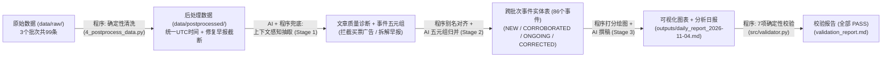

# Daily_AI_Insight_Engine（AI 舆情分析日报系统）

本项目是一个面向中英文多源科技资讯的 **按批次增量抽取、事件归并、口径核对与日报生成系统**。系统从原始抓取数据出发，按日期批次顺序（`BATCH-1: 2026-11-02` $\rightarrow$ `BATCH-2: 2026-11-03` $\rightarrow$ `BATCH-3: 2026-11-04`）完成数据清洗、结构化五元组抽取、跨语种事件合并、数据更正追踪、可视化图表绘制、分析日报生成及程序化校验。

---

## 一、 快速启动（一条命令跑完全流程）

### 1. 环境准备与运行
系统核心抽取与归并逻辑基于 Python 3.10+ 标准库实现，可视化依赖 `matplotlib`（见 [`requirements.txt`](file:///d:/Pcode/outside/data_vis/requirements.txt)）。系统内置 **实时 API 调用 + 本地确定性缓存（`data/cache/llm_cache.json`）** 双模式：无论是否配置外部 API Key，均可直接运行以下命令一键复现从原始数据到最终日报的全流程：

```bash
# 1. 安装可视化依赖（若已安装 matplotlib 可跳过）
pip install -r requirements.txt

# 2. （可选）如需重新发起实时大模型请求，可复制 .env.example 为 .env 并填入 API Key；
#    若不配置 .env，系统将自动读取 data/cache/llm_cache.json 确定性完成全流程。
cp .env.example .env

# 3. 一条命令从原始数据按批次顺序跑完全流程（后处理清洗 -> 三批次抽取与事件归并 -> 生成可视化与日报 -> 自动校验）
python run_pipeline.py
```

### 2. 仓库目录与交付物索引

```text
├── run_pipeline.py                  # 【一键入口】从原始数据按批次跑完全流程生成日报与校验报告
├── .env.example                     # 环境变量模板（密钥通过 .gitignore 隔离，不入库）
├── rules/                           # 【事先定义的规则文件】
│   ├── event_taxonomy_and_merge_rules.json  # 6大事件分类、6类质量标签、实体别名表与归并规则配置
│   └── event_rules_spec.md                  # Schema设计理由、AI易错点、分类体系与跨批次归并规则说明
├── data/
│   ├── raw/                         # 【原始数据】99 条中英文跨 3 日原始抓取数据（保持原貌未修改）
│   ├── staging/                     # 【采集暂存】含 159 条丢弃数据明细 (discarded_items_log.json)
│   ├── postprocessed/               # 【清洗后数据】统一 UTC 时间戳并补全极客公园早报截断正文
│   ├── intermediate/                # 【中间产物】各批次结构化结果、事件实体表快照与程序校验报告
│   │   ├── batch_1_2026-11-02_extractions.json & batch_1_2026-11-02_events.json
│   │   ├── batch_2_2026-11-03_extractions.json & batch_2_2026-11-03_events.json
│   │   ├── batch_3_2026-11-04_extractions.json & batch_3_2026-11-04_events.json
│   │   ├── entity_aliases_snapshot.json     # 跨批次动态扩充的实体别名映射表
│   │   ├── merge_audit_log.json             # 跨条目/跨批次合并决策审计日志
│   │   └── validation_report.json / .md     # 7 项程序化校验结果报告
│   └── cache/llm_cache.json         # 本地确定性 LLM 响应缓存
├── docs/                            # 【项目文档与协作记录】
│   ├── data_collection_log.md       # 数据采集记录（来源、筛选标准、丢弃的 159 条数据及原因）
│   ├── data_issues.md               # 数据中发现的 7 类真实质量问题、涉及条目与系统处理方式
│   └── 协作记录.md                   # 与 AI 协作及纠错的关键过程记录
├── outputs/                         # 【最终交付成果】
│   ├── daily_report_2026-11-04.md   # 最终批次分析日报（含焦点事件解析、跨日追踪与趋势研判）
│   └── figures/                     # 自动化生成的可视化图表
│       ├── fig1_daily_overview_2026-11-04.png  # 图1：当日重点事件排行与分类分布
│       └── fig2_cross_batch_changes.png        # 图2：跨批次事件变化与演进追踪
├── scripts/                         # 数据抓取、初筛、正文扩充与确定性后处理脚本 (1~4_*.py)
└── src/                             # 核心源码（LLM客户端、抽取与归并器、可视化、日报生成、校验器）
```

---

## 二、 数据源说明：选了什么、为什么、放弃了什么及可靠度评估

详见 [`docs/data_collection_log.md`](file:///d:/Pcode/outside/data_vis/docs/data_collection_log.md) 与 [`docs/data_issues.md`](file:///d:/Pcode/outside/data_vis/docs/data_issues.md)。系统从 258 条初抓候选资讯中筛选出连续 3 天（`2026-11-02` 至 `2026-11-04`）的 **99 条有效资讯（英文 63 条、中文 36 条）**，丢弃 159 条（丢弃明细见 `data/staging/discarded_items_log.json`）：

| 信源类型 | 采纳的具体来源 | 为什么选它 & 可靠度评估 | 放弃的来源及原因 |
| :--- | :--- | :--- | :--- |
| **1. 中英文科技媒体**<br>（共 63 条） | **TechCrunch AI、The Verge AI、量子位 QbitAI、极客公园、Solidot、OSChina、少数派** | **优势**：时效快、覆盖广，适合捕捉同一事件的中英文各自报道。<br>**可靠度问题**：国内自媒体（如量子位）存在惊悚标题党（`EXAGGERATED_TITLE`）和企业公关软文（`PR_PROMOTION`）；极客公园早报将十余条快讯拼在一篇且含汽车/游戏非 AI 杂讯（`MULTI_TOPIC_DIGEST`）；TechCrunch 混有线下峰会售票广告（`EVENT_AD`）。 | **机器之心 / 36氪 RSS**：XML 存在未转义字符解析报错或停更。<br>**VentureBeat AI**：请求触发 `HTTP 429` 限流。<br>**WSJ / The Information**：遵守题目要求，不使用付费墙内容。 |
| **2. 官方与学术渠道**<br>（共 16 条） | **OpenAI Blog、HuggingFace Blog、arXiv (`cs.AI/cs.CL`)、GitHub Releases (`vllm`/`llama.cpp`/`langchain` 等)** | **优势**：一手权威发布，技术参数与版本号最准确，可用来核对和纠正二手媒体的夸大表述。<br>**可靠度问题**：企业官方博客（如 OpenAI 电网计划公告）带有单方公关倾向；arXiv 单日论文过多、GitHub 同日连发多个小版本，需做同源限流去重。 | **Anthropic / Meta 官方博客**：无公开标准全文 RSS，其关键动态通过 S-1 招股书披露报道与社区信源覆盖。 |
| **3. 技术社区讨论**<br>（共 20 条） | **Hacker News**（抓取高赞主帖 + 前排高赞评论） | **优势**：一线工程师评论能有效指出财报或公关稿背后的统计猫腻（如指出 Anthropic 230 亿亏损源于可转债公允价值减计、指出 3.2 万亿 AI 隐性债务包含了数十年常规机房租约），提供关键的核查视角。 | **Reddit / X (Twitter)**：公开接口反爬严格，且短评碎片化噪音过高，信噪比不如 Hacker News 高赞技术讨论。 |

---

## 三、 系统设计：整体流程、Schema 设计、关键决策与人机分工

### 1. 整体流程架构



### 2. 结构化 Schema 设计理由与 AI 易错点说明
详见 [`rules/event_rules_spec.md`](file:///d:/Pcode/outside/data_vis/rules/event_rules_spec.md)。核心字段设计及防错机制如下：

| 字段名称 | 设计理由（解决什么问题） | AI 填写时容易出什么错 | 系统防错措施 |
| :--- | :--- | :--- | :--- |
| `quality_flags` & `discarded_subtopics` | 先识别标题党、软文、买票广告、旧闻，并把早报里的汽车/游戏快讯剥离掉。 | 漏标几个月前的旧闻；或把早报里的非 AI 数码快讯也抽成事件。 | 程序计算 `发布日 - 发生日 > 3天` 强制补标 `STALE_NEWS`；要求先输出早报丢弃清单再输出保留事件。 |
| `actors`（主体） | 事件归并的第一检索键，找出涉及同一家公司/模型的历史事件。 | 照抄标题党的“某国产AI”；或中英文写法不同（`千问` vs `Qwen`）导致合并不上。 | 强制从正文还原真实全称 + 程序维护 `entity_aliases` 字典自动将中英文异名统一为标准名。 |
| `action` & `target_objects`（源头动作与标的） | 区分“同一主体的不同独立事件”（防误合）与“同一事件的不同报道角度”（防漏合）。 | **最易错**：把“媒体的报道切入点”当成“现实源头动作”，导致同源自一份招股书的多篇报道合并不上。 | **上下文感知抽取**：读新文章时把当前已有事件的简明索引一起传给 AI，带着历史事件记忆抽五元组。 |
| `metrics_ledger`（数据口径台账） | 记录关键数字及统计前提，支撑识别跨日“数据更正”和日报精确引用。 | 只抄数字（如“降本90%”），漏抄前提（如“56块B200自建”）；或内部写未转义双引号导致 JSON 报错。 | 强制拆为 `指标名 + 数值 + 统计前提(scope_note)` 并由程序绑定 `item_id`；客户端内置引号自动修复器。 |
| `source_items` & `timeline`（证据链） | 保证事件表和日报的每条结论都能查回原始 `item_id`。 | 让 AI 手写长串编号时容易编造不存在的 ID，或在日报中把 A 事件的 ID 塞进 B 事件括号里。 | 事件表的 ID 追加**全由 Python 代码完成**；日报生成后由程序自动校验修正事件-条目绑定关系。 |

### 3. 哪些环节交给程序（Code），哪些环节交给 AI（LLM）？

| 环节 | 由确定性程序（Python 代码）完成 | 由大模型（AI）完成 |
| :--- | :--- | :--- |
| **Step 1：数据清洗** | 统一多时区时间格式为 ISO 8601 UTC；重新拉取修复极客公园早报截断；正则剥离文内促销横幅；按关键词兜底拦截纯买票广告（`EVENT_AD`）；计算时差自动标记旧闻（`STALE_NEWS`）。 | 识别语义层面的标题党夸大（`EXAGGERATED_TITLE`）、企业公关通稿（`PR_PROMOTION`）与自我证伪传闻（`UNVERIFIED_RUMOR`）；将多事件早报拆解为独立 AI 事件并剥离非 AI 快讯。 |
| **Step 2：事件归并** | 维护 `entity_aliases` 字典标准化中英文主体名；结合候选推荐与主体/标的交集召回历史事件；按状态优先级更新事件表、追加 `source_items`、`timeline` 与 `metrics_ledger`。 | 在阅读原文时对照活跃事件索引识别跨语种同指（如 `算力园区` $\leftrightarrow$ `compute campuses`）；比对五元组判断属于 `NEW / CORROBORATED / ONGOING / CORRECTED` 并生成口径修正说明。 |
| **Step 3：可视化与日报** | 按多维公式计算最后批次事件重要度得分（自动扣除纯软文/旧闻权重）；使用 `matplotlib` 绘制当日与跨批次两张统计图；基于通用 Schema 规则（跨批次属性、`status=='CORRECTED'`、`metric_resolution_note`、风险标签）自动归集当日有效事件、低质过滤清单、跨日发酵与口径更正素材包（零硬编码事件 ID）。 | 基于程序按规则筛选出的结构化事件素材，遵循平实、克制、零自媒体修辞的通用分析方法论分段生成日报正文，并在关键事实与结论句末自然嵌入 `[EVT-xxx \| ITEM-xxx (字段名)]` 引用。 |
| **Step 4：质量校验** | 独立运行 `src/validator.py` 执行 7 项硬校验（Schema 完整性、分类枚举、ID 真实性、广告拦截、跨批次单调性、日报引用与事件表配对核查）。 | **完全不参与裁判**（校验逻辑由独立 Python 代码执行，不依赖大模型自评）。 |

---

## 四、 AI 使用方式：Prompt 设计与出错处理机制

1. **三阶段结构化 Prompt 设计**：
   - **Stage 1（质量标签识别与结合已有事件抽取 Prompt）**：先让模型输出文章级质量标签和早报丢弃子话题，再结合注入的“当前活跃事件极简索引”抽取标准化事件五元组及疑似关联的 `candidate_event_ids`。
   - **Stage 2（五元组对齐与口径演进 Prompt）**：仅在召回候选事件时触发。明确给出“同源动作合并”与“同主体不同动作隔离”正反准则，要求先写 `reasoning` 再输出合并决策。
   - **Stage 3（通用规则筛选 + 分段式客观撰稿 Prompt）**：为避免 Prompt 过拟合特定日期新闻或长上下文触发网关超时，先由 Python 按 Schema 字段规则自动组装当日有效事件、低质过滤清单、跨日发酵、口径核对及历史背景素材包，再分两次流式调用大模型生成“今日主要事件与背景影响分析”和“跨批次变化与趋势判断”，通过通用方法论指令严格约束平实克制文风与证据边界说明。
2. **AI 调用出错时的工程容错处理**：
   - **关闭长思考链 + 开启 SSE 流式传输**：针对 `LongCat-2.5-Preview` 默认开启思考模式耗时过长及长文生成易触发远端网关断开（`WinError 10054`）的问题，显式设置 `"enable_thinking": False` 并在长文生成时启用 `"stream": True` 流式接收，配合指数退避重试（最多 5 次）。
   - **基于 `JSONDecodeError.pos` 的未转义引号自动修复**：模型在中文摘要中偶尔会输出未转义的英文双引号（如 `"compute campuses"`）导致 JSON 解析失败；[`src/llm_client.py`](file:///d:/Pcode/outside/data_vis/src/llm_client.py) 中的 `robust_parse_json` 会根据报错游标位置自动将其替换为中文引号 `「...」` 完成恢复。
   - **分类枚举前缀兜底对齐**：若模型输出的 `category` 出现细微字符偏差，程序通过前缀匹配自动对齐至规则文件中的标准枚举。

---

## 五、 校验方法与结果（含发现并纠正的 AI 错误）

我们**不信任 AI 的以下四类输出**：① 模型输出可能超出预设分类枚举范围；② 提取或引用的条目 ID 可能存在编造或张冠李戴；③ 单靠语义理解可能无法完全拦截商业广告与跨月旧闻；④ 跨批次合并时可能遗漏正文中的背景关联。

因此，[`src/validator.py`](file:///d:/Pcode/outside/data_vis/src/validator.py) 实现了 **7 项纯程序化校验**（报告见 [`data/intermediate/validation_report.md`](file:///d:/Pcode/outside/data_vis/data/intermediate/validation_report.md)），全部 **PASS**：
- `VAL-01` **覆盖率与 Schema 完整性**：99/99 条资讯全部处理，86 个事件五元组必填字段缺失数为 `0`；
- `VAL-02` **枚举边界校验**：86 个事件的分类、状态与质量标签越界数为 `0`；
- `VAL-03` **事件表溯源 ID 真实性**：关联的 94 条原始资讯 ID 经比对全部真实存在，无编造 ID；
- `VAL-04` **纯商业峰会广告拦截**：3 条 TechCrunch 峰会买票软文（`026`, `008`, `009`）已全部成功拦截，未混入事件表；
- `VAL-05` **数据质量问题检出审计**：共检出公关软文 19 条、旧闻 8 条、早报合集 4 条、标题党 3 条、买票广告 3 条、未证实传闻 2 条；
- `VAL-06` **跨批次规模演进与多源归并**：事件库规模 `29 -> 71 -> 86` 单调递增，成功识别 **18 个** 多源/跨批次合并事件（含 **10 个** 中英文跨语种对齐事件、**3 个** `CORRECTED` 数据更正事件、**2 个** `ONGOING` 持续进展事件）；
- `VAL-07` **分析日报与可视化引用核对**：日报引用的 38 个事件与 42 条原始资讯均真实存在，且每个 `[EVT-xxx | ITEM-xxx]` 方括号内的条目与事件表严格对应，错配数为 `0`。

### 开发与校验过程中发现并纠正的典型 AI 错误（详见 [`docs/协作记录.md`](file:///d:/Pcode/outside/data_vis/docs/协作记录.md)）
1. **错误 1：Stage 1“盲抽”导致隐蔽同源事件漏合并**
   - **现象**：早期原型（`prototype_test/run_prototype.py`）让 AI 孤立抽取单篇新闻五元组时，AI 把《数据中心改用旧喷气发动机发电》（`ITEM-20261103-002`）和《xAI 密西西比数据中心安装 8 台喷气发动机》（`040`）抽成了完全不搭界的动作，导致漏合；
   - **纠正**：改为在 Stage 1 注入活跃事件简明索引，让 AI 带着上下文抽五元组并直接推荐候选事件 ID。
2. **错误 2：早报合集把边缘一句话快讯也抽成独立事件**
   - **现象**：极客公园早报末尾有一句话快讯（如数码配件、车企销量），AI 一股脑全抽成了十几个碎片事件；
   - **纠正**：在 Prompt 中增加“篇章结构权重与 AI 核心度”过滤准则，强制先输出 `discarded_subtopics` 剥离非 AI 快讯。
3. **错误 3：日报引用括号内“张冠李戴”（被 `VAL-07` 抓获）**
   - **现象**：由于 `ITEM-20261102-026` 是买票广告被拦截，后续事件编号顺延了 1 位；在撰写日报背景时，曾出现将 `ITEM-20261102-029` 错误绑定到 `EVT-029`（实际 `EVT-029` 对应 `030`），以及把两个不同事件的 `ITEM-ID` 合写进同一个 `[EVT-xxx | ...]` 方括号的情况；
   - **纠正**：`VAL-07` 校验器立即报错拦截，我们在 [`src/report_generator.py`](file:///d:/Pcode/outside/data_vis/src/report_generator.py) 中增加了 `_verify_and_sanitize_citations` 后置映射清洗函数，根据真实事件表自动拆分对齐每个方括号内的配对。

---

## 六、 已知局限，以及如果再给我一天会改进什么

### 1. 当前系统的已知局限
1. **Stage 1 注入事件索引的线性膨胀问题**：当前把活跃事件的极简索引（每条约 35 字）放进 Stage 1 Prompt，在 3 天（86 个事件，约 3,000 字）规模下效果极佳；但如果连续运行一个月（累积上千个事件），Prompt 长度会超出最佳注意力窗口并增加成本。
2. **对“同一客观动作、极度不同粒度”的归并粒度权衡**：例如 Anthropic 提交 S-1 招股书这一大动作下，既有讨论“8954 亿算力承诺与 169.6 亿营收”的财务报道（`EVT-016`），也有专门讨论“第 29 页 RSI 递归自我改进风险条款”的安全报道（`EVT-002`）和“内部 AI 消耗超员工薪酬”的花絮（`EVT-017`）。目前系统按具体议题焦点保留了这 3 个细粒度子事件，尚未引入“母事件（Parent Event）— 子事件（Sub-Event）”的层级树结构。
3. **静态图表交互性有限**：当前生成的 PNG 图表适合在 Markdown 报告中直接阅读，但无法鼠标悬停查看每个事件节点的原文链接和完整口径台账。

### 2. 如果再给我一天，我会改进什么？
1. **引入“时间窗口衰减 + 本地轻量向量/BM25 预召回”替代全量索引注入**：仅向 Stage 1 注入最近 7 天活跃事件或通过关键词/Embedding 预筛出的 Top 15 相关历史事件，使系统能够支撑全年 365 天无限期增量运行而不会撑爆上下文。
2. **升级为“母事件簇（Storyline）— 原子事件（Atomic Event）”双层结构**：将“Anthropic IPO 招股书披露”作为母事件簇，下挂“财务与算力承诺（`EVT-016`）”、“RSI 安全风险警告（`EVT-002`）”等子事件，兼顾宏观脉络聚合与微观议题独立性。
3. **增加细粒度数值级 NLI（自然语言推断）自动核查器**：在当前校验器检查 `EVT-ID` 与 `ITEM-ID` 绑定关系的基础上，进一步用正则提取日报正文中的所有百分比和金额数字，自动与对应事件 `metrics_ledger` 中的 `value` 字段做精确比对，实现从“引用编号防幻觉”到“句内数值防篡改”的升级。
