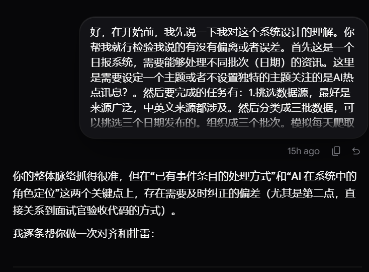
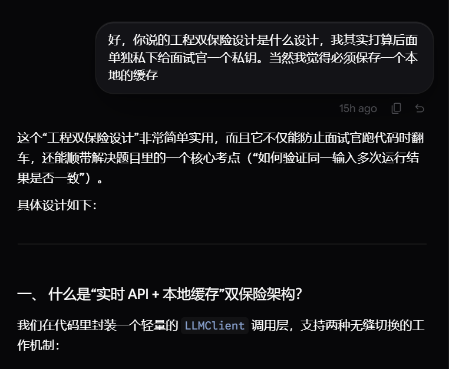
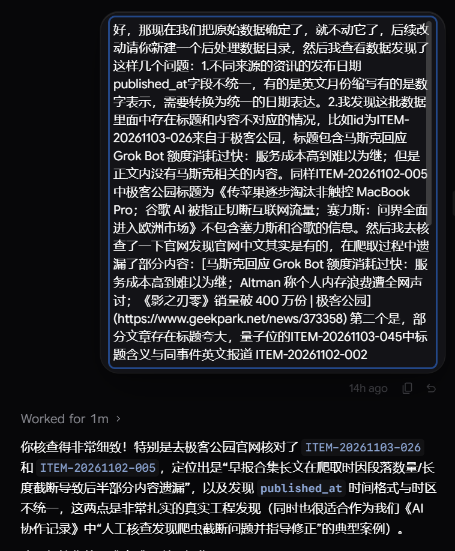
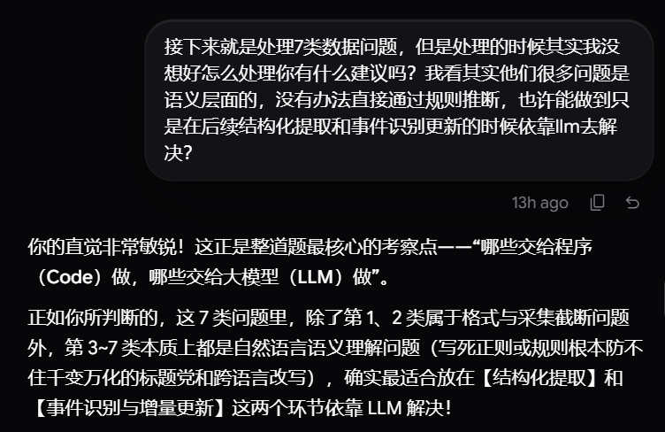
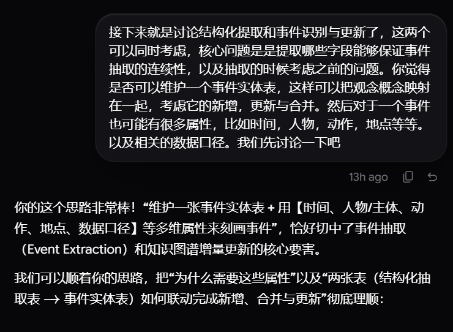
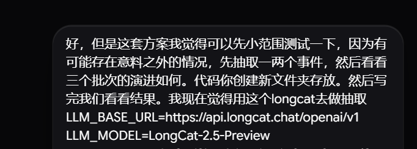
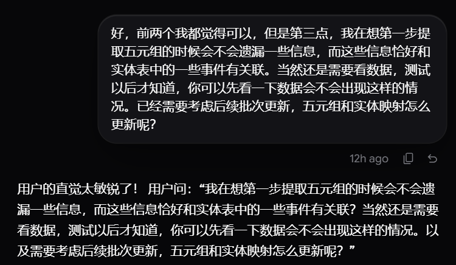
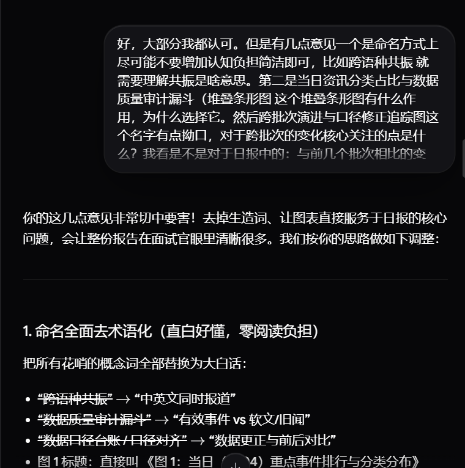
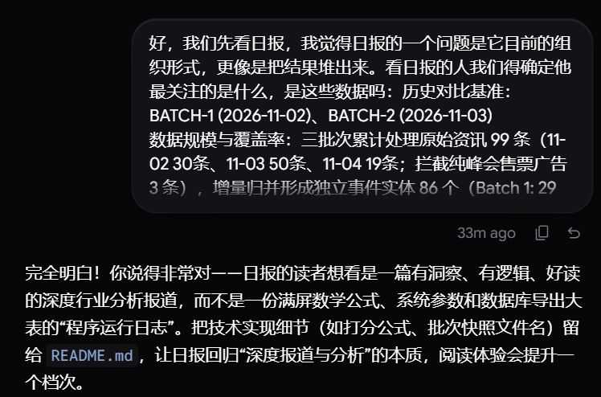

# 人机协作记录

## 1. 与 AI 对齐项目需求
开始前先向 AI 说明对赛题的理解，核对多源中英文数据按三个日期分批处理、模拟每日增量更新的整体流程。

## 2. 协定交付物形式
讨论代码交付与 API 密钥问题，确定采用“实时 API 调用 + 本地缓存”的双保险方案，保证无密钥环境下也能直接运行复现。

## 3. 说明数据中存在的问题
保持原始数据目录不动并新建后处理目录，人工核查数据与原网页，指出发布时间格式不统一、极客公园早报爬取内容截断遗漏、量子位标题夸大等问题。

## 4. 讨论如何处理问题和规则化提取
针对整理出的 7 类数据问题讨论处理分工：格式统一和内容补抓由程序处理，语义层面的问题放到后续结构化提取和事件识别更新阶段由 LLM 解决。

## 5. 提出提取方案
提出维护一张事件实体表来管理事件的新增、更新与合并，并围绕时间、人物、动作、地点及数据口径等属性设计结构化提取字段。

## 6. 小范围测试
接入 LongCat 模型，在独立文件夹中先抽取一两个事件测试三个批次的演进流程，排查潜在问题后再处理全量数据。

## 7. 细化提取方案的细节
指出单步提取五元组可能遗漏与实体表已有事件关联的信息，讨论在提取时结合已有事件上下文，以及后续批次更新时五元组和实体映射的更新方式。

## 8. 日报和可视化的命名问题
指出初版命名存在理解门槛（如“跨语种共振”），要求改用直白简洁的表述，并明确两张可视化图表各自对应的日报内容。

## 9. 日报的组织形式存在问题
指出初版日报更像数据结果堆砌，要求从读者关注点出发重新组织日报结构。

