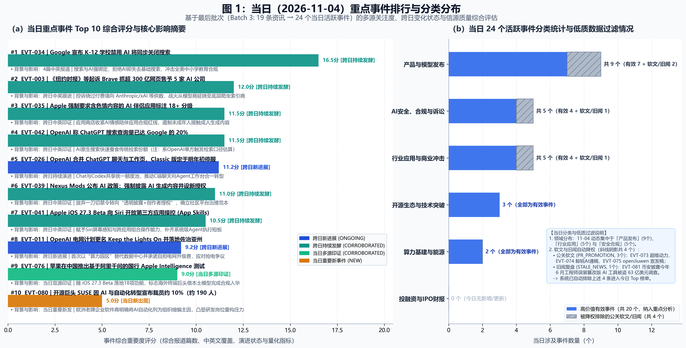
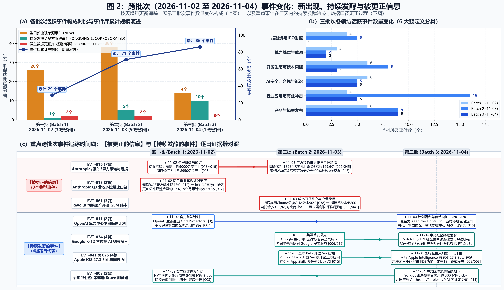

# AI 行业舆情分析日报（2026年11月4日）

2026年11月4日，Google 宣布自明年起默认对 K-12 学生禁用 AI 工具，且由于 AI 功能与搜索深度整合，选择关闭 AI 的学校将同步失去 Google 搜索服务；《纽约时报》等四家出版商在曼哈顿联邦法院起诉 Brave Software，指控其抓取逾 300 亿网页建立索引并向 Anthropic、Perplexity、Mistral、xAI、Cohere 等 AI 公司供数；苹果在中国推出基于阿里千问模型的 Apple Intelligence 功能（iOS 27.3 开发者 Beta），首批开放约 18 项功能，同日 iOS 27.3 开发者预览版向全球 Siri 开放第三方应用操作能力；德国开源软件公司 SUSE 宣布因 AI 与自动化转型计划裁减约 10% 员工。

## 一、 今日主要事件与背景影响分析

### 1. Google 将 K-12 学校搜索服务与 AI 功能绑定

Google 计划自明年起默认对 K-12 学生禁用 AI 工具，学校管理员需主动开启方可使用。由于 AI 功能已深度集成至 Google 搜索，选择完全禁用 AI 的学校将无法访问搜索引擎及 AI Overviews。Google 教育副总裁 Chris Phillips 向《纽约时报》表示，搜索与 AI 已深度融合，此举旨在回应教育工作者和家长希望对孩子 AI 互动拥有更多掌控权的诉求。[EVT-034 | ITEM-20261103-006 (timeline)] [EVT-034 | ITEM-20261103-019 (timeline)] [EVT-034 | ITEM-20261104-012 (timeline)] [EVT-034 | ITEM-20261104-018 (timeline)]

该事件获得 4 篇中英文报道交叉确认，跨两个批次持续跟踪，是当日信息密度最高的事件。美国 K-12 学校广泛使用 Gmail、Docs、Classroom 及 Chromebook 等 Google 教育生态产品，管理员在关闭 AI 功能时面临搜索服务同步中断的实际约束。HN 社区评论指出存在替代搜索引擎，部分用户认为这是教育领域降低对 Google 依赖的机会。[EVT-034 | ITEM-20261103-006 (summary)]

同期，OpenAI 消费产品负责人 Adam Fry 表示，ChatGPT 当前触发的网络搜索请求量已相当于 Google 搜索量的约 20%。该统计口径为用户问题触发实际网络检索的次数，不包括未调用搜索的普通聊天；OpenAI 未完整解释用于对比的 Google 搜索数据来源，该比例属于公司自行估算。[EVT-042 | ITEM-20261103-017 (key_metrics)] [EVT-042 | ITEM-20261104-005 (summary)] 这一数据与 Google 在教育场景下对 AI 搜索的管控形成对照：一方面 AI 搜索在消费端持续扩大使用量，另一方面 Google 在特定垂直场景中主动收缩 AI 功能的默认开放范围。

### 2. 《纽约时报》等四大出版商起诉 Brave 抓取超 300 亿网页向 AI 公司供数

《纽约时报》、每日新闻、芝加哥论坛报及奥兰多哨兵报在曼哈顿联邦法院起诉 Brave Software，指控其通过未识别爬虫抓取逾 300 亿网页构建 Brave Index 索引数据库、绕过付费墙、拦截出版商广告并销售自有广告，同时将抓取内容非法分发给 Anthropic、Perplexity、Mistral、xAI 和 Cohere 等 AI 客户。Brave 累计融资约 2.5 亿美元，暂未回应。[EVT-003 | ITEM-20261102-003 (summary)] [EVT-003 | ITEM-20261102-003 (key_metrics)] [EVT-003 | ITEM-20261104-011 (key_metrics)]

该诉讼的特点在于被告方并非 AI 模型开发商，而是为 AI 公司提供网页索引数据的第三方搜索引擎运营商。诉讼涉及的五家 AI 客户均为当前主流大模型企业，表明内容版权争议正从模型训练环节向数据供应链环节延伸。

此前，OpenAI、谷歌、微软和 Anthropic 于 11 月 2 日宣布采用一项新标准，内容发布方可通过 robots.txt 文件一次性向多家 AI 企业统一声明 AI 训练内容使用偏好，无需逐家设置规则。[EVT-005 | ITEM-20261102-005 (summary)] 但 Brave 被指控使用未识别爬虫，意味着其抓取行为不受 robots.txt 声明的有效约束。此外，Reddit CEO 霍夫曼在 Q3 财报电话会议上表示，Google 仍在大量抓取 Reddit 内容，但 AI 搜索模式不再为 Reddit 带来相应访问量，反映出 AI 搜索对内容平台流量分配的实质性影响。[EVT-006 | ITEM-20261102-005 (summary)]

### 3. 苹果 iOS 27.3 推进国行千问模型测试与全球 Siri 第三方应用操作开放

苹果从 2026 年 11 月 4 日起在中国推出 Apple Intelligence，基于与阿里巴巴合作的千问模型，用户可通过 iOS 27.3 开发者 Beta 版测试。首批功能约 18 项，包括实时翻译、写作工具、视觉智能、照片消除工具、Siri 接入千问、智绘表情、邮件与通知摘要、备忘录、通话等。正式版计划于 2026 年 12 月随 iOS 27.3 正式版发布。[EVT-076 | ITEM-20261104-005 (timeline)] [EVT-076 | ITEM-20261104-008 (key_metrics)] [EVT-076 | ITEM-20261104-008 (timeline)]

同日，Apple 在 iOS 27.3 开发者预览版中宣布开发者可将 Siri AI 的新功能集成至所有第三方应用，使语音助手能够利用用户个人上下文、处理自然语言提示并使用屏幕感知完成请求。同时新增 App Skills（应用技能）机制，允许开发者将多个任务组合为单一操作供 Siri 调用，更新也扩展了 Siri 对苹果自有应用的操作能力。[EVT-041 | ITEM-20261103-015 (timeline)] [EVT-041 | ITEM-20261104-005 (timeline)]

这两项更新分别对应苹果在本地化合规和系统级助手功能上的推进。国行版本选择与阿里巴巴千问模型合作，是苹果在中国市场满足 AI 服务合规要求的具体安排；App Skills 机制则标志着 Siri 从单一指令执行向跨应用任务组合的方向扩展，开发者可将其应用的多步操作封装为 Siri 可调用的单一技能。

### 4. SUSE 宣布因 AI 与自动化调整裁员约 10%

德国开源软件公司 SUSE 现有约 1900 名员工，CEO Dirk-Peter van Leeuwen 宣布因自动化和 AI 从根本上改变软件公司运营方式，计划裁减约十分之一员工（约 190 人）。该决定在公司被瑞典私募股权殷拓集团收购后进行战略审视后做出，受影响员工将在 11 月 4 日前收到通知。[EVT-080 | ITEM-20261104-009 (summary)] [EVT-080 | ITEM-20261104-009 (key_metrics)]

同日，HN 社区用户指出 Google Gemini 个人订阅用户的全部保存聊天历史默认被用于模型训练，且没有独立退出选项，用户只能完全关闭聊天历史或使用临时会话。Google 官方支持页面明确警告不要输入机密信息，并承认人工审核员可能阅读这些记录。[EVT-084 | ITEM-20261104-016 (summary)] 该讨论反映出 AI 服务在用户数据使用透明度方面持续面临社区审视，与 SUSE 裁员事件共同指向 AI 与自动化对软件行业运营模式的双重影响——既涉及企业内部运营效率调整，也涉及终端用户对数据边界的关注。

**低质与非当日数据过滤说明：** 今日另有 3 篇单源企业宣传通稿因缺乏独立信源核实被标记为 `PR_PROMOTION`，分别为超维动力在香港金融科技周的展会宣传（EVT-073）、虎鲸文娱「鲸锐AI」平台上线通稿（EVT-074）、openJiuwen 旗下 AgentMemory 产品宣发稿（EVT-075）。另有 1 篇币安披露 63 亿美元加密货币被盗事件的调查报告（EVT-081），因事件实际发生时间为 2026 年 6 月，早于发布日达 5 个月，被标记为 `STALE_NEWS`。上述 4 篇均已按规则降权排除，不纳入今日主要事件。

---

## 二、 与前几批相比的变化：持续发酵、信息更正与今日新动态

### 2.1 持续发酵与跨日推进的事件

**OpenAI 电网合作计划公布首站选址并调整设施称谓（EVT-011）**：该事件从 11月2日 发布 `Grid Protectors Program` 起持续演进。11月2日，OpenAI 官方博客宣布该计划，将与电力公司合作，确保未来算力园区（compute campuses）的电力需求不影响电网可靠性，并保护消费者电价 [EVT-011 | ITEM-20261102-007 (summary)]。11月4日的后续报道披露，该计划公告中首次以「compute campuses」（算力园区）替代「data centers」（数据中心），首个站点位于佐治亚州 Effingham County，旨在应对极端天气下 AI 基础设施对当地电网的压力 [EVT-011 | ITEM-20261104-015 (summary)]。这一称谓调整的背景是数据中心建设面临的电网接入瓶颈——11月3日《纽约时报》报道，因电网接入和新涡轮机等待时间长达数年，部分 AI 数据中心运营商开始使用从退役飞机拆卸并改装为燃烧天然气的喷气发动机自行发电，Rystad Energy 分析师 Audun Martinsen 表示喷气发动机方案可在 24 个月内让数据中心运行，而北弗吉尼亚接入 100 兆瓦电网需约 7 年 [EVT-031 | ITEM-20261103-002 (summary)]；同日，xAI 在密西西比州数据中心安装了 8 台同类改装喷气发动机以绕过电网接入排队 [EVT-062 | ITEM-20261103-040 (summary)]。批评者认为 OpenAI 应正面解决公众对数据中心的担忧而非进行品牌重塑 [EVT-011 | ITEM-20261104-015 (summary)]。

**OpenAI 合并 ChatGPT 标签页并明确 Classic 版停用日期（EVT-026）**：11月2日，OpenAI 向用户发送邮件，宣布将 ChatGPT 中的 Chat 与 Work 标签页合并，用户可在同一界面中从探索想法到让 ChatGPT 完成实际任务，同时 ChatGPT 与 Codex 将共享同一 token 额度池，初期向部分用户开放以收集反馈 [EVT-026 | ITEM-20261102-027 (summary)]。11月4日的跟进报道明确 ChatGPT Classic 将于 2027年1月30日 正式停止服务，聊天记录将迁移至新版 ChatGPT 应用；总裁 Greg Brockman 此前承认新版界面「确实有点混乱」，希望年底前取消 Work 标签页 [EVT-026 | ITEM-20261104-005 (summary)]。

**其余跨日跟进事件**：Apple 要求约会应用及含色情内容的 AI 伴侣应用标注 18+ 年龄分级（EVT-035），11月3日 宣布自 11月16日 起生效，11月4日 跟进报道确认开发者需在 App Store Connect 年龄分级问卷中新增位置共享和约会与关系两项内容描述 [EVT-035 | ITEM-20261103-007 (summary), ITEM-20261104-005 (summary)]。Nexus Mods 公布 AI 生成内容政策（EVT-039），11月3日 宣布新上传模组须披露 AI 使用情况，11月4日 补充明确现有 Mod 需在 2027年1月2日 前合规 [EVT-039 | ITEM-20261103-013 (summary), ITEM-20261104-007 (summary)]。百度 Apollo 发布全模态世界模型 Apollo World（EVT-070），11月3日 首次公开，11月4日 补充披露模型能生成供无人车测试的虚拟城市，车辆和行人由 AI 智能体控制，实时生成摄像头画面和激光雷达点云 [EVT-070 | ITEM-20261103-048 (summary), ITEM-20261104-005 (summary)]。

**前文已述事件的跨批次跟进**：Google 宣布 K-12 学校禁用 AI 功能将同步关闭搜索服务（EVT-034），11月3日 首次报道后，11月4日 由 Google 教育副总裁 Chris Phillips 向纽约时报确认搜索与 AI 已深度融合，学校若选择禁用 AI 功能，学生将无法使用搜索服务 [EVT-034 | ITEM-20261104-012 (summary), ITEM-20261104-018 (summary)]。纽约时报等出版商起诉 Brave 抓取超 300 亿网页（EVT-003），11月2日 首次报道后，11月4日 跟进确认 Brave Index 索引规模超过 300 亿网页，并将数据库提供给 Anthropic、Perplexity、Mistral、xAI 和 Cohere 等 AI 客户 [EVT-003 | ITEM-20261102-003 (summary), ITEM-20261104-011 (summary)]。OpenAI 称 ChatGPT 搜索查询量已达 Google 的 20%（EVT-042），11月3日 由 OpenAI 消费产品负责人 Adam Fry 在发布会上提出，11月4日 跟进报道补充统计口径为用户问题触发实际网络检索的次数，不包括未调用搜索的普通聊天，且 OpenAI 未完整解释用于对比的谷歌搜索数据来源 [EVT-042 | ITEM-20261103-017 (summary), ITEM-20261104-005 (summary)]。Apple 在 iOS 27.3 开发者预览版中向 Siri AI 开放第三方应用操作能力（EVT-041），11月3日 首次报道后，11月4日 跟进确认开发者可向 Siri 提供应用内操作接口，并引入 App Skills 机制 [EVT-041 | ITEM-20261103-015 (summary), ITEM-20261104-005 (summary)]。

### 2.2 被更正的信息与数据口径核对

**Anthropic S-1/A 招股书支出承诺精确化与亏损性质说明（EVT-016）**：该事件经历了多轮数据修正。11月2日初报援引 Anthropic 上周提交的 IPO 注册声明，指出其脚注披露近 9000 亿美元支出承诺（多延续至 2030 年代）[EVT-016 | ITEM-20261102-013 (summary)]；同日后续报道表述为「约 8950 亿美元」[EVT-016 | ITEM-20261102-018 (summary)]。11月3日，根据修订版 S-1/A 招股书，支出承诺精确化为 **8954 亿美元**，供应商包括亚马逊、谷歌、SpaceX 及 Neoclouds 等算力租赁新贵 [EVT-016 | ITEM-20261103-045 (summary)]。同时，Q3 营收精确为 **169.6 亿美元**（约 1130 亿元人民币，同比增长 1127%），算力成本占营收比例从 Q2 的 48% 升至 58% [EVT-016 | ITEM-20261103-005 (summary), ITEM-20261103-026 (summary)]。此外，Q3 约 230 亿美元账面净亏损主要源于可转换票据及衍生负债公允价值变动的会计准则减计，并非实际现金消耗，Q3 实际营业亏损为 5.67 亿美元（Q2 为 9.74 亿美元营业利润）[EVT-016 | ITEM-20261102-018 (summary), ITEM-20261103-026 (summary)]。

**Anthropic Q3 营收环比增速口径差异（EVT-015）**：11月2日初报按 Q2（116 亿美元）至 Q3（168 亿美元）计算环比增长 45%（52 亿美元），低于 Q2 的 141%（68 亿美元）[EVT-015 | ITEM-20261102-012 (summary)]。同日修订版披露环比增速放缓至约 19%，差异可能源于口径调整（如月度化或剔除一次性收入）[EVT-015 | ITEM-20261102-017 (metric_correction_note)]。同时新增 9 个月累计财务数据：截至 Q3 的 9 个月累计营收 330 亿美元，运营支出 345 亿美元，运营亏损 12.5 亿美元；总资产 1540 亿美元对比现金负债 1460 亿美元 [EVT-015 | ITEM-20261102-017 (summary)]。

**Revolut 切换开源智谱 GLM 降本 90% 的前提条件说明（EVT-061）**：11月3日初报披露 Revolut 将约 2000 名工程师的 AI 编程工具从 Claude Code 和 Codex 切换为自托管 Zhipu GLM（部署于 56 块 Nvidia B200 GPU），混合成本约每百万 token 0.30 美元，账单降至原先约十分之一（成本降低约 90%）[EVT-061 | ITEM-20261103-038 (summary), ITEM-20261103-039 (summary)]。同日后续报道补充明确：该数据基于部署 56 块 Nvidia B200 GPU 实现每百万 token 0.30 美元混合成本，且编码时间缩短 60%、交付前置时间缩短 70% 的内部自测数据**未隔离取消限额等其他变量** [EVT-061 | ITEM-20261103-041 (summary)]。

**夸大标题与未证实传闻澄清**：量子位《RSI 我们快要控制不住了》标题夸大——Anthropic 修订版 S-1/A 招股书第 29 页明确指出，公司预判模型可能即将触达负责任扩展政策定义的「由 AI 驱动的大幅加速进展」阈值，但强调当前模型尚未跨越该阈值，目前在役模型仍在控制范围内 [EVT-002 | ITEM-20261103-037 (summary), ITEM-20261103-045 (summary)]。HuggingFace 疑似泄露 GPT-6.2-Astra/Claude 权重传闻——报道正文自认「不太可能是真的」，属未证实传闻 [EVT-022 | ITEM-20261102-023 (warnings)]。

### 2.3 今日新出现的其他动态

11月4日首次出现的其他有效事件包括：

- **招商局狮子山实验室发布具身推理模型「驭物 Lion-ER-35B-A3B」**（EVT-072）：采用 MoE 架构总参数约 35B、每 Token 仅激活约 3B 参数，通过能力牵引的具身数据引擎而非盲目堆砌数据，在十项主流具身基准上实现全部指标上涨。团队将具身推理拆解为实体、空间、时序、物理、可供性、任务、社会、证据等 8 个一级领域、39 项二级能力 [EVT-072 | ITEM-20261104-001 (summary)]。

- **Nvidia RTX Spark 笔记本在 Linux 下因固件无法读取电源管理信息锁频约 780MHz**（EVT-085）：导致 120B 参数模型推理速度从 Windows 下的约 65 tokens/s 骤降至不足 14 tokens/s（约 35%）。原因在于 Linux 当前无法读取相关电源管理固件 [EVT-085 | ITEM-20261104-017 (summary)]。

- **富士胶片因云厂商与数据中心冷备份及物理隔离需求扩大磁带产能**（EVT-079）：大型云服务商和数据中心运营商正在扩大对磁带的使用，磁带能以相对较低成本存储海量数据，且可实现物理隔离（air-gap），为 AI 时代的数据备份提供最后一道防线 [EVT-079 | ITEM-20261104-006 (summary)]。

- **媒体爆料字节跳动视频模型 Seedance 海外收入占比达 50%**（EVT-077）：据《智能涌现》爆料，字节跳动旗下视频生成模型 Seedance 海外收入占比已达 50%，过去半年海外市场收入增长近 5 倍。腾讯位列 Seedance 中国区客户前三，B 站进入前十 [EVT-077 | ITEM-20261104-005 (summary)]。

- **腾讯据报准备发布 C 端 AI 搜索引擎**（EVT-078）：有媒体称腾讯即将发布一款面向 C 端用户的 AI 搜索引擎，界面极简、全面 AI 化，强化权威信源排序，将 AI 问答与网页搜索揉在同一体验里。腾讯内部人士透露，该搜索引擎与元宝 App 内置搜索、腾讯云元宝搜索 API 共享同一套底层能力 [EVT-078 | ITEM-20261104-005 (summary)]。

- **开源项目更新**：LangChain 发布 langchain-typesafe 0.0.1 正式版本，包含实验性 AutoModeMiddleware 和 ModelRouterMiddleware 中间件功能（EVT-082）[EVT-082 | ITEM-20261104-013 (summary)]；llama.cpp 发布 b12110 版本并将版本号升级至 0.9.0（EVT-083）[EVT-083 | ITEM-20261104-014 (summary)]；华为仓颉语言原生编码 Agent cjh 开源发布，支持在终端中用自然语言描述任务，Agent 自主规划、调用工具、观察结果并迭代直至完成（EVT-086）[EVT-086 | ITEM-20261104-019 (summary)]。

---

## 三、 证据范围内的趋势判断

**1. 数据中心建设面临明显的电网并网周期瓶颈，企业同步背负大额长期基建支出承诺。** 北弗吉尼亚接入 100 兆瓦电网需约 7 年，而改装退役喷气发动机方案可在 24 个月内让数据中心运行 [EVT-031 | ITEM-20261103-002 (key_metrics)]；xAI 在密西西比州数据中心安装了 8 台改装喷气发动机以绕过电网接入排队 [EVT-062 | ITEM-20261103-040 (summary)]；OpenAI 落地佐治亚州 Effingham County 电网合作站点，并在公告中首次以「compute campuses」替代「data centers」[EVT-011 | ITEM-20261104-015 (summary)]。与此同时，Anthropic 披露 8954 亿美元 AI 基础设施支出承诺 [EVT-016 | ITEM-20261103-045 (summary)]，美国科技巨头 AI 相关表外债务半年增长 90% 达 3.2 万亿美元，承诺与义务总额已达资产的 80% [EVT-064 | ITEM-20261103-043 (summary)]。需要指出的是，针对 3.2 万亿美元表外债务中常规长期机房租约与纯 AI 专项债务的具体占比，社区与现有报道仍存在统计口径争议——HN 评论中有人指出该数据包含数十年期的数据中心租赁和电力支付承诺，即使 AI 完全失败，数据中心仍有其他用途，因此风险被夸大 [EVT-064 | ITEM-20261103-043 (warnings)]。当前样本不足以评估具体的债务违约风险。

**2. AI 搜索功能加快嵌入主流入口，引发网站流量下滑争议与网页抓取诉讼。** Google 在 K-12 学校强行绑定搜索与 AI 功能，学校若选择禁用 AI 功能，学生将无法使用搜索服务 [EVT-034 | ITEM-20261104-012 (summary)]；Reddit CEO 霍夫曼在 Q3 财报电话会议上表示 Google 仍在大量抓取 Reddit 内容，但 AI 搜索模式不再为 Reddit 带来相应访问量 [EVT-006 | ITEM-20261102-005 (summary)]；纽约时报等出版商起诉 Brave 抓取超 300 亿网页建立索引并提供给 Anthropic、Perplexity、Mistral、xAI、Cohere 等 AI 公司 [EVT-003 | ITEM-20261102-003 (summary)]；OpenAI、谷歌、微软、Anthropic 联合推行 robots.txt 退出标准 [EVT-005 | ITEM-20261102-005 (summary)]。需要说明的是，OpenAI 称 ChatGPT 搜索量达 Google 20% 系企业单方按「触发网络检索次数」估算且未公开对比基准 [EVT-042 | ITEM-20261103-017 (summary)]；腾讯筹备 AI 搜索 [EVT-078 | ITEM-20261104-005 (summary)] 与字节 Seedance 海外收入占比 [EVT-077 | ITEM-20261104-005 (summary)] 均仅来自单一媒体爆料。因缺乏独立第三方监测数据，当前样本不足以判断搜索市场的真实份额变化。

**3. 推理侧调用量增长推动稀疏架构与自托管降本尝试，但现有个案尚不足以推演商业 API 萎缩或行业普遍裁员。** 赛迪研究院报告显示，截至 2026 年 6 月中国日均词元调用量超过 175 万亿，相比 2024 年初增长 1000 多倍，AI 推理数据量首次超过训练数据量 [EVT-008 | ITEM-20261102-005 (summary)]；招商局发布 35B 总参数、每 Token 激活 3B 的 MoE 具身推理模型 [EVT-072 | ITEM-20261104-001 (summary)]；Revolut 用 56 块 B200 自托管智谱 GLM 将每百万 token 成本降至 0.30 美元 [EVT-061 | ITEM-20261103-039 (summary)]。需要明确指出：**当前样本不足以得出「闭源商业 API 收入即将萎缩」或「AI 已引发软件行业普遍裁员潮」的结论**——前者有 Anthropic Q3 营收仍同比增长 1127% 达 169.6 亿美元作为反证 [EVT-016 | ITEM-20261103-045 (summary)]，且 Revolut 自建 56 块 B200 硬件门槛较高、提速数据未隔离混杂变量 [EVT-061 | ITEM-20261103-041 (metric_correction_note)]；后者在三天数据中仅有 SUSE 一家处于私募并购重组期的企业披露裁员 10% [EVT-080 | ITEM-20261104-009 (summary)]，无法分离并购精简与 AI 替代的各自影响，样本量不足以向全行业外推。
